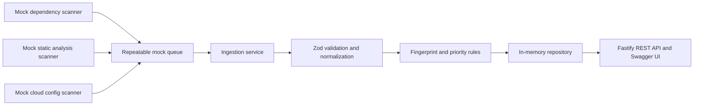

# Security Findings Hub

A compact TypeScript backend that ingests fictional findings from three simulated security scanners, normalizes and deduplicates them, assigns explainable contextual priorities, and exposes the results through a documented REST API. This is a portfolio demonstration, not a scanner or a production risk engine.

## Problem and architecture

Security tools describe issues in different formats. A useful findings service needs to validate those inputs, produce a common model, avoid duplicate records, and give consumers stable, queryable results. This project demonstrates that path with deterministic fixtures and an in-memory store.



The queue returns the same 12 raw records on every run. One duplicate within each batch produces 11 unique records. A startup ingestion runs once per process, so `/api/findings` is useful immediately. Manual ingestion exercises the same service; later runs update existing findings instead of creating duplicates.

## Design decisions

- Domain scoring and fingerprinting are pure functions. Scanner-specific data ends at the normalizers.
- Zod validates raw scanner input and HTTP requests. The Fastify Zod provider derives OpenAPI schemas from the same route schemas.
- A SHA-256 fingerprint uses source, application, category, and source-specific identity. It excludes time, severity, and descriptive text. The full fingerprint is also the public ID.
- Repository upsert is a synchronous `Map` operation. Reingestion preserves ID, original `detectedAt`, and manually set status; it refreshes `lastSeenAt`, descriptive fields, and priority. An older ingestion clock never moves `lastSeenAt` backward.
- Priority uses an illustrative score: critical/high/medium/low = 80/60/35/10, production/staging/development = +15/+5/+0, and internet-facing = +15. Thresholds are P0 ≥95, P1 ≥75, P2 ≥40, otherwise P3. `priorityReasons` explains each term. This is **not** a real-world risk assessment standard.
- List results sort by ID before pagination. Exact application filtering is case-sensitive. Summary includes open **and resolved** findings.
- Malformed individual scanner records are counted as rejected; safe validation issue paths and codes are logged. Infrastructure failures remain errors and are not hidden as rejected records.

## Stack and local setup

Node.js 24 LTS, strict TypeScript, Fastify with Pino logging, Zod, Swagger UI, Vitest, ESLint, and Prettier. No database, cloud account, secrets, or paid services are needed.

```bash
nvm use                 # if you use nvm; .nvmrc selects Node 24
npm install
npm run dev             # http://localhost:3000
```

Production-style local run:

```bash
npm run build
npm start
```

The server listens on `0.0.0.0` and uses `PORT` when set, otherwise port 3000. Open `http://localhost:3000/docs/` for the interactive API documentation.

## API

| Method | Path                 | Purpose                            |
| ------ | -------------------- | ---------------------------------- |
| GET    | `/health`            | Process health                     |
| POST   | `/api/ingestion/run` | Run one mock batch                 |
| GET    | `/api/findings`      | List and filter findings           |
| GET    | `/api/findings/:id`  | Get a finding                      |
| PATCH  | `/api/findings/:id`  | Set `open` or `resolved`           |
| GET    | `/api/summary`       | Counts including resolved findings |
| GET    | `/docs/`             | Swagger UI                         |

`GET /api/findings` accepts `severity`, `priority`, `status`, `application`, `limit` (1–100, default 20), and `offset` (nonnegative, default 0). Its response is `{ "data": [...], "total": 11, "limit": 20, "offset": 0 }`. Invalid input returns HTTP 400; missing IDs return HTTP 404. Unexpected failures return HTTP 500 without a stack trace.

Example calls:

```bash
curl http://localhost:3000/health
curl 'http://localhost:3000/api/findings?priority=P0&limit=5'
curl -X POST http://localhost:3000/api/ingestion/run
curl -X PATCH http://localhost:3000/api/findings/FINDING_ID \
  -H 'content-type: application/json' \
  -d '{"status":"resolved"}'
```

After startup, the first manual ingestion returns `{"processed":12,"created":0,"updated":12,"rejected":0}`. The duplicate fixture is counted as an update. A finding has an ISO 8601 `detectedAt` from the scanner fixture and a `lastSeenAt` from ingestion time.

## Validation and tests

```bash
npm run typecheck
npm run lint
npm test
npm run build
```

Tests cover all scanner formats, malformed records, stable fingerprints, priority boundaries, duplicate and repeat ingestion, status preservation, repository copy isolation, filtering, pagination, summary counts, API validation, and missing resources. HTTP tests use Fastify injection without an external server.

## Deploy to Render

The included `render.yaml` is a Blueprint for one free Node web service. Connect this GitHub repository in Render and create a Blueprint instance, or create a free Web Service manually with:

- Build command: `npm install && npm run build`
- Start command: `npm start`
- Health check path: `/health`
- Node version: 24, selected by `.nvmrc` and `engines`

After deployment, open `https://YOUR-SERVICE.onrender.com/docs/`, `/health`, and `/api/findings`. No environment variables or secrets are required. Render provides `PORT`. Startup seed ingestion recreates demo data after every process restart. Free service availability and sleep behavior follow Render's current free-tier terms.

## Mocked infrastructure and limitations

The queue is a static, repeatable fixture adapter. It does **not** provide SQS delivery, retries, visibility timeouts, or durability. The repository is process-local memory; data, status edits, and idempotency history disappear on restart and are not shared between instances. The public ingestion and status endpoints have no authentication or rate limits because this is a demo. The findings and identifiers are synthetic and were not verified against any real application.

For production, an SQS adapter could receive scanner messages, acknowledge only after durable writes, retry transient failures, and route poison messages to a dead-letter queue. A database would need a unique fingerprint constraint and atomic upsert to preserve idempotency across workers and restarts. Authentication, authorization, rate limits, audit events, scanner trust boundaries, and more mature risk signals would also be needed. Fastify emits structured Pino logs to standard output, which a hosting platform could forward to an observability service; no external telemetry integration is included.

## AI-assisted development

This project was developed with AI assistance under human-directed architecture, validation, and review. Generated code was checked with strict typechecking, linting, tests, a production build, and local HTTP checks. AI-generated code is not inherently correct, and this demo does not claim professional Node.js production deployment experience.
