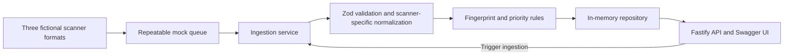

# Security Findings Hub

[](https://github.com/arielszklarkiewicz/security-findings-hub/actions/workflows/ci.yml)

Security Findings Hub is a lightweight Node.js/TypeScript backend that consolidates, deduplicates, and prioritizes findings from several security tools. Those tools use different record formats; turning their output into a useful queue requires a common model, stable duplicate detection, and context-aware ranking.

The service explores those problems with **Fastify, TypeScript, Zod, Swagger UI, and Vitest**. It uses synthetic findings, a repeatable mock queue, and process-local memory.

**[Explore the Live API](https://security-findings-hub.onrender.com/docs/)** · The demo is public and has no authentication.

## Engineering Highlights

- **Multi-source ingestion:** Three scanner-specific Zod schemas validate dependency, static analysis, and cloud configuration records before normalization.
- **Idempotent processing:** Stable fingerprints make repeated ingestion update existing findings instead of creating duplicates.
- **Contextual prioritization:** An explainable score combines severity, environment, and internet exposure.
- **Testable architecture:** Normalization, fingerprinting, and scoring sit outside the Fastify routes and are exercised by automated tests.
- **Production considerations:** The mock queue and in-memory repository show where durable messaging and persistence adapters would fit.

## Architecture



The mock queue returns 12 records, including one duplicate. Startup ingestion produces 11 unique findings. Later ingestion receives the same batch and updates those findings.

## Try the Live Demo

1. Open the [Swagger documentation](https://security-findings-hub.onrender.com/docs/).
2. Run `GET /api/findings` to see the 11 seeded findings.
3. Filter with `priority=P0`, copy an ID, and run `GET /api/findings/:id` to inspect its `priorityReasons`.
4. Run `POST /api/ingestion/run`. Its `created` count is `0`; run it again to confirm no new findings are created.
5. Run `PATCH /api/findings/:id` with `{ "status": "resolved" }`.
6. Re-run ingestion, then retrieve the finding to confirm its status remains `resolved`.
7. Run `GET /api/summary` to see counts by severity, priority, status, and application.

## Run and test

```bash
nvm use                    # .nvmrc selects Node 24.21.0
npm ci
npm run dev                # http://localhost:3000/docs/
```

For a production-style local run, use `npm run build && npm start`. The server binds to `0.0.0.0` and reads `PORT`, defaulting to `3000`. Run the full checks with:

```bash
npm run typecheck
npm run lint
npm test
npm run build
```

## API Reference

| Method | Path                 | Purpose                                    |
| ------ | -------------------- | ------------------------------------------ |
| GET    | `/health`            | Process health                             |
| GET    | `/docs/`             | Interactive Swagger documentation          |
| GET    | `/api/findings`      | List and filter findings                   |
| GET    | `/api/findings/:id`  | Inspect one finding                        |
| POST   | `/api/ingestion/run` | Ingest the repeatable mock batch           |
| PATCH  | `/api/findings/:id`  | Set status to `open` or `resolved`         |
| GET    | `/api/summary`       | Aggregate all findings, including resolved |

Use Swagger UI for the complete flow, or set `BASE_URL` to the local server or the deployed URL:

```bash
BASE_URL=http://localhost:3000
curl "$BASE_URL/health"
curl "$BASE_URL/api/findings?priority=P0&limit=5"
curl "$BASE_URL/api/findings/FINDING_ID"              # copy a P0 ID from the list
curl -X POST "$BASE_URL/api/ingestion/run"
curl -X PATCH "$BASE_URL/api/findings/FINDING_ID" \
  -H 'content-type: application/json' -d '{"status":"resolved"}'
curl "$BASE_URL/api/summary"
```

Each manual ingestion returns `{"processed":12,"created":0,"updated":12,"rejected":0}`; the duplicate within the batch counts as an update.

`GET /api/findings` accepts `severity`, `priority`, `status`, and exact case-sensitive `application` filters, plus `limit` (1–100; default 20) and `offset` (nonnegative; default 0). Results sort by ID before pagination. Invalid requests return HTTP 400, oversized bodies return 413, missing IDs return 404, and unexpected failures return a generic 500 response.

## Design decisions

- **Scanner-specific normalization:** Zod validates each raw format before the normalizer maps its fields into one finding model. A malformed record is rejected without discarding valid records in the same batch.
- **Deterministic deduplication:** SHA-256 hashes the source, application, category, and source-specific identity. Mutable details such as severity, description, and timestamps do not change the fingerprint. The fingerprint is also the public ID. Reingestion preserves ID, original `detectedAt`, and manually set status while refreshing current details, priority, and `lastSeenAt`.
- **Contextual priority:** The illustrative score adds severity (critical/high/medium/low: 80/60/35/10), environment (production/staging/development: 15/5/0), and internet exposure (15). P0 starts at 95, P1 at 75, P2 at 40, and lower scores are P3. `priorityReasons` shows the calculation. This is not a risk assessment standard.
- **Mocked infrastructure:** A fixed queue and process-local repository keep the demo runnable without accounts or paid services. A real queue adapter could add acknowledgments, retries, and dead-letter handling. A database adapter would need a unique fingerprint constraint and atomic upsert for idempotency across workers and restarts.

## Deploy to Render

The included [`render.yaml`](render.yaml) defines **one free Node web service**, with no database or paid resources. In the Render dashboard, connect this repository and either create a Blueprint from `render.yaml` or create a Web Service with these exact settings:

| Setting               | Value                                 |
| --------------------- | ------------------------------------- |
| Service type          | Web Service                           |
| Language/runtime      | Node                                  |
| Instance type         | Free                                  |
| Root directory        | Repository root                       |
| Build command         | `npm ci && npm run build`             |
| Start command         | `npm start`                           |
| Health check path     | `/health`                             |
| Node version          | `24.21.0` from `.nvmrc`               |
| Environment variables | None required; Render supplies `PORT` |

The deployed service is at `https://security-findings-hub.onrender.com`. Check `/health`, `/docs/`, and `/api/findings`. Startup ingestion runs on each process start, so the demo is populated without a separate seed command.

## Limits and security scope

The queue is a fixture, not a durable message broker. The repository is process-local memory: findings, status edits, and deduplication history disappear on restart and are not shared between instances. Render's free service can spin down when idle and has no persistent disk; a restart reseeds the original 11 findings. No external database is required for this demo.

The ingestion and status endpoints are public, with no authentication, authorization, or rate limiting. Findings and identifiers are synthetic. Do not use this service for real security data or decisions. Fastify writes structured logs to standard output; no external telemetry is configured.

## AI-assisted development

An experienced C#/.NET backend engineer used AI coding tools to accelerate implementation and explore the Node.js/TypeScript ecosystem. Explicit requirements and architecture decisions guided the work: **requirements and architecture → implementation → automated validation → code review → refinement**. AI generated substantial portions of the initial code. Tests and a running-service walkthrough checked behavior; review then corrected an HTTP error-handling defect and added regression coverage. Generated code still requires critical evaluation and verification.
