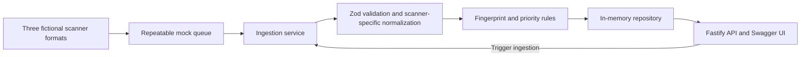

# Security Findings Hub

A small TypeScript API that ingests fictional dependency, static analysis, and cloud configuration findings. It validates each scanner format, normalizes findings into one model, deduplicates repeated reports, and assigns an explainable priority. Teams face this same integration problem when several tools report overlapping issues in different formats.

**Stack:** Node.js 24, TypeScript, Fastify, Zod, Swagger UI, Vitest, and an in-memory repository. **Demonstrates:** input validation, deterministic identity, idempotent ingestion, contextual scoring, REST design, and automated tests. This is a portfolio demo using synthetic data, not a security scanner or production risk engine.

**Live demo after deployment:** `https://<your-render-service>.onrender.com/docs/` opens the Swagger UI. The service has not been published from this repository yet. The API is intentionally public and has no authentication.

## Architecture



The mock queue returns 12 records, including one duplicate. Startup ingestion produces 11 unique findings. Each later ingestion receives the same batch and updates those findings.

## Run and test

```bash
nvm use                    # .nvmrc selects Node 24.21.0
npm ci
npm run dev                # http://localhost:3000/docs/
```

For a production-style local run, use `npm run build && npm start`. The server binds to `0.0.0.0` and reads `PORT`, defaulting to `3000`. Run the full checks with:

```bash
npm run typecheck
npm run lint
npm test
npm run build
```

## API and demo walkthrough

| Method | Path                 | Purpose                                    |
| ------ | -------------------- | ------------------------------------------ |
| GET    | `/health`            | Process health                             |
| GET    | `/docs/`             | Interactive Swagger documentation          |
| GET    | `/api/findings`      | List and filter findings                   |
| GET    | `/api/findings/:id`  | Inspect one finding                        |
| POST   | `/api/ingestion/run` | Ingest the repeatable mock batch           |
| PATCH  | `/api/findings/:id`  | Set status to `open` or `resolved`         |
| GET    | `/api/summary`       | Aggregate all findings, including resolved |

Use Swagger UI for the complete flow, or run these requests with `BASE_URL=http://localhost:3000` (replace it with the Render URL after deployment):

```bash
curl "$BASE_URL/health"
curl "$BASE_URL/api/findings?priority=P0&limit=5"
curl "$BASE_URL/api/findings/FINDING_ID"              # copy a P0 ID from the list
curl -X POST "$BASE_URL/api/ingestion/run"
curl -X POST "$BASE_URL/api/ingestion/run"             # created remains 0
curl -X PATCH "$BASE_URL/api/findings/FINDING_ID" \
  -H 'content-type: application/json' -d '{"status":"resolved"}'
curl "$BASE_URL/api/summary"
```

The list starts with 11 findings. A P0 finding shows `priorityReasons` for its score. Each manual ingestion returns `{"processed":12,"created":0,"updated":12,"rejected":0}`; the duplicate within the batch counts as an update. After a status change, the summary counts one more resolved finding, and later ingestion preserves that status.

`GET /api/findings` accepts `severity`, `priority`, `status`, and exact case-sensitive `application` filters, plus `limit` (1–100; default 20) and `offset` (nonnegative; default 0). Results sort by ID before pagination. Invalid requests return HTTP 400, oversized bodies return 413, missing IDs return 404, and unexpected failures return a generic 500 response.

## Design decisions

- **Scanner-specific normalization:** Zod validates each raw format before the normalizer maps its fields into one finding model. A malformed record is rejected without discarding valid records in the same batch.
- **Deterministic deduplication:** SHA-256 hashes the source, application, category, and source-specific identity. Mutable details such as severity, description, and timestamps do not change the fingerprint. The fingerprint is also the public ID. Reingestion preserves ID, original `detectedAt`, and manually set status while refreshing current details, priority, and `lastSeenAt`.
- **Contextual priority:** The illustrative score adds severity (critical/high/medium/low: 80/60/35/10), environment (production/staging/development: 15/5/0), and internet exposure (15). P0 starts at 95, P1 at 75, P2 at 40, and lower scores are P3. `priorityReasons` shows the calculation. This is not a risk assessment standard.
- **Mocked infrastructure:** A fixed queue and process-local repository keep the demo runnable without accounts or paid services. A real queue adapter could add acknowledgments, retries, and dead-letter handling. A database adapter would need a unique fingerprint constraint and atomic upsert for idempotency across workers and restarts.

## Deploy to Render

The included [`render.yaml`](render.yaml) defines **one free Node web service**, with no database or paid resources. In the Render dashboard, connect this repository and either create a Blueprint from `render.yaml` or create a Web Service with these exact settings:

| Setting               | Value                                 |
| --------------------- | ------------------------------------- |
| Service type          | Web Service                           |
| Language/runtime      | Node                                  |
| Instance type         | Free                                  |
| Root directory        | Repository root                       |
| Build command         | `npm ci && npm run build`             |
| Start command         | `npm start`                           |
| Health check path     | `/health`                             |
| Node version          | `24.21.0` from `.nvmrc`               |
| Environment variables | None required; Render supplies `PORT` |

After deployment, set the live-demo URL near the top of this README to the assigned `onrender.com` address. Check `/health`, `/docs/`, and `/api/findings`. Startup ingestion runs on each process start, so the demo is populated without a separate seed command.

## Limits and security scope

The queue is a fixture, not a durable message broker. The repository is process-local memory: findings, status edits, and deduplication history disappear on restart and are not shared between instances. Render's free service can spin down when idle and has no persistent disk; a restart reseeds the original 11 findings. No external database is required for this demo.

The ingestion and status endpoints are public, with no authentication, authorization, or rate limiting. Findings and identifiers are synthetic. Do not use this service for real security data or decisions. Fastify writes structured logs to standard output; no external telemetry is configured.

## AI-assisted development

The workflow was **planning → implementation → validation → review → iteration**. AI assistance generated much of the initial code; a technical review checked behavior, corrected an HTTP error-handling defect, added regression coverage, and verified the built server over HTTP.
